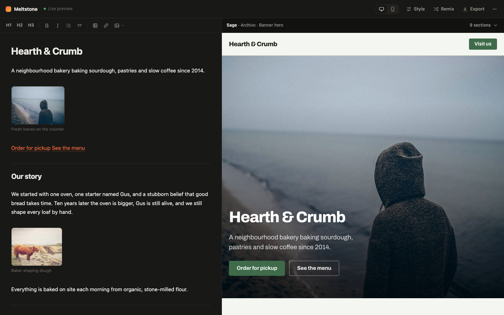

# Meltstone

**Turn a Markdown document into a designed, responsive website, with no AI and no build step.**



Write your content in a rich Markdown editor on the left and watch it become a website on the right. Meltstone reads the _shape_ of your content (a list of years, a group of photos, questions under a heading) and chooses a fitting layout for each section. The look is chosen from hand-picked palettes, font pairings and layouts that are known to work together. The same text always produces the same site, and you can export it as a folder or a single HTML file that works offline.

## Features

- **Rich Markdown editor.** It works like Obsidian's live preview: headings, emphasis, links, quotes and image thumbnails render as you type, and the raw Markdown shows only on the line you're editing.
- **Tables.** GitHub-style pipe tables (with `:---:` alignment) render as responsive, themed tables inside any section. In the editor they're edited in place, cell by cell (Tab and Enter to move, **⊞** in the toolbar to insert one).
- **Layouts from content.** Galleries, cards, pricing tables, FAQs, stats, timelines, testimonials, contact cards and call-to-action bands are chosen from what each section contains.
- **A different look for every site.** The style is seeded from the site title and nudged by keywords ("café", "API", "studio"…), so two sites rarely look alike. **Remix** tries another look.
- **Full control when you want it.** The Style panel sets palette, accent color, fonts, heading size, corner radius, button shape, card style, hero, section backgrounds, alignment, navigation, section numbers and spacing. Anything left on _Auto_ stays generated.
- **Live preview without flicker.** Updates are patched into the open page, so images, scroll position and opened FAQ items stay put. Live preview can be turned off.
- **Offline-ready export.** Export a `.zip` folder (`index.html`, `images/`, `fonts/`) or a single HTML file with every image and font embedded.
- **Your own images.** Upload, drag in or paste images. They're resized in the browser and bundled into the export.
- **No runtime dependencies.** The app is plain ES modules and the generated sites are static HTML and CSS. It contains no LLM, no backend and no tracking.

## Quick start

Requires [Node.js](https://nodejs.org) 18 or newer, which is only used to serve the files locally.

```bash
git clone <repository-url> meltstone
cd meltstone
npm start
```

Open http://localhost:5173. The example site loads on first run. Use **⋯ → Load example content** to get it back later.

There's nothing to install: `npm start` runs a tiny static file server (`server.js`) with no dependencies. Any static server works, as long as it serves the folder over HTTP, because browsers block ES modules on `file://`.

## Writing your site

```markdown
# Hearth & Crumb

A neighbourhood bakery baking sourdough since 2014.


[Order for pickup](https://example.com/order) [See the menu](#menu)

## What we bake

### Sourdough

A 36-hour ferment and a blistered crust.

### Viennoiserie

Croissants laminated with cultured butter.

## By the numbers

- **10** years baking
- **400+** loaves a day

## Visit us

12 Mill Lane, Riverside
hello@hearthandcrumb.com
```

| You write                       | You get                                         |
| ------------------------------- | ----------------------------------------------- |
| `# Title` (first line)          | Site name, page title and nav brand             |
| First paragraph after the title | Tagline                                         |
| First image before any `##`     | Hero image                                      |
| A line containing only links    | A row of buttons (the first is the primary one) |
| `## Heading`                    | A new section and a nav item                    |

Each `##` section's layout is picked from its content:

| Section contains                                               | Layout                                |
| -------------------------------------------------------------- | ------------------------------------- |
| 3+ images and little text                                      | Gallery                               |
| One image and text                                             | Image beside text (alternating sides) |
| Two or more `###` sub-headings                                 | Cards                                 |
| `###` sub-headings ending in `?`                               | FAQ (expandable)                      |
| `###` sub-headings with prices (`$`, `€`, `£`, `¥`)            | Pricing table                         |
| A list of `**Name** — description` items                       | Numbered cards                        |
| A list starting with numbers (`**400+** loaves a day`)         | Stats                                 |
| A list starting with years (`2019 — Founded`)                  | Timeline                              |
| `> quotes` (an optional last line `— Name` becomes the credit) | Testimonials                          |
| A heading like "Contact", or an email address                  | Contact card                          |
| Only links                                                     | Call-to-action band                   |
| Anything else                                                  | Text                                  |

If a guess is wrong, force a layout by adding it to the heading: `## Our work {gallery}`. The layouts are `prose`, `split`, `gallery`, `cards`, `listCards`, `pricing`, `faq`, `stats`, `timeline`, `testimonials`, `contact` and `cta`.

The full guide is also in the app under **⋯ → Formatting guide**.

## Styling

Open **Style** in the top bar to adjust the look. Every control starts on **Auto** and shows what was generated; picking a value pins it, and the **Auto** link next to a control unpins it. **Remix** changes everything that's still on Auto.

The same settings can be written as front matter at the top of the document. The Style panel wins when both are set.

```yaml
---
palette: Midnight # Paper Sage Porcelain Blush Sunny Lilac Mono Midnight Forest Ember Ink Ocean
mode: dark # dark | light: pick a palette of that kind
accent: '#ff5a36'
font: Sora # Fraunces Playfair Space DM Syne Bricolage Cormorant Instrument Sora Lora Archivo
scale: 1.333 # heading size: 1.2 | 1.25 | 1.333
radius: 12 # corner radius in px (0–48)
buttons: pill # square | rounded | pill
cards: elevated # outlined | filled | elevated
hero: banner # centered | split | banner | bigtype
rhythm: lines # section backgrounds: alternate | lines | plain
align: center # section headings: left | center
nav: pill # bar | pill
numbers: off # section numbers: on | off
spacing: airy # compact | normal | airy
seed: anything # seeds the automatic choices instead of the title
---
```

## Exporting

**Export** offers two formats:

- **Website folder (.zip)** contains `index.html` plus `images/` and `fonts/`, all referenced by relative paths. Upload the folder to any static host (GitHub Pages, Netlify, S3, a plain web server).
- **Single HTML file** has every image and font embedded as base64, which makes it easy to email or share.

Export downloads remote images and the Google Fonts files from the browser. A few image hosts don't allow this (CORS). Those images keep linking to their original URL, and the app tells you how many were affected.

## How it works

Everything is deterministic: the same document, settings and Remix count always produce the same HTML.

```
Markdown ──► parse ──► classify ──► choose theme ──► render ──► HTML
             structure  layout per   palette, fonts,  standalone page
                        section      shapes, layout
```

1. **Parse** (`src/parser.js`). Markdown becomes a document tree: title, tagline, hero blocks, then sections (`##`) and sub-sections (`###`). Only the subset of Markdown that maps to a website is supported.
2. **Classify** (`src/classify.js`). Each section is matched against layout rules, from most to least specific.
3. **Choose a theme** (`src/themes.js`). A seeded random generator picks from curated lists, weighted toward options that suit the detected mood. Every pick is always drawn in the same order, so pinning one setting doesn't reshuffle the others. Front matter and Style panel settings are applied on top.
4. **Render** (`src/render.js`). The theme and sections become one HTML document with inline CSS: a nav, the hero, the sections and a footer. User text is escaped, and links with `javascript:` or other unknown schemes are replaced with `#`.

In the app, the style seed and mood are fixed per document the first time it's built, so editing the title or adding keywords doesn't change the look while you type.

### Project structure

```
index.html              App shell
app.css                 App styles (the generated sites carry their own CSS)
server.js               Zero-dependency static server for local development
src/
  app.js                Wires the editor, preview, style panel and export together
  editor.js             Live-preview Markdown editor on CodeMirror 6
  parser.js             Markdown → document tree
  classify.js           Section → layout rules
  themes.js             Palettes, font pairings, mood detection, seeded theme choice
  render.js             Document + theme → standalone HTML/CSS
  preview-runtime.js    Runs inside the preview iframe and patches updates in place
  style-panel.js        The Style panel UI
  export.js             Collects images and fonts, packages zip or single file
  zip.js                Minimal ZIP writer (stored entries, CRC-32)
  sample.js             Example document and formatting guide text
vendor/
  codemirror.js         Pre-built CodeMirror bundle (committed so no build is needed)
  codemirror-entry.js   What goes into that bundle
  THIRD_PARTY_LICENSES.txt
scripts/
  vendor.mjs            Rebuilds the bundle and its license notices
```

## Development

The app has no build step: edit a file and reload the page. Node is used only for `npm start`.

The CodeMirror editor is pre-bundled into `vendor/codemirror.js`. You only need dev dependencies to change which CodeMirror pieces are bundled, or their versions:

```bash
npm install
npm run vendor     # rebuilds vendor/codemirror.js and vendor/THIRD_PARTY_LICENSES.txt
```

Common changes:

- **Add a palette or font pairing:** add an entry to `PALETTES` or `FONTS` in `src/themes.js`. Tag it with `moods` so it's preferred for matching content. Check that text and accent colors have enough contrast against the background.
- **Add a layout:** add a rule in `classify()` (`src/classify.js`), a label in `KIND_LABELS`, a renderer in `RENDER` (`src/render.js`) and its CSS in `css()`. Then document it in `src/sample.js` and in this README.
- **Add a style setting:** add it to `STYLE_OPTIONS` and `applyStyle()` in `src/themes.js`, use it in `css()`, and add a control to `GROUPS` in `src/style-panel.js`.

You can try the generator outside the browser:

```bash
node --input-type=module -e "
import { build } from './src/render.js';
import { SAMPLE } from './src/sample.js';
console.log(build(SAMPLE).report);"
```

## Privacy

Meltstone runs entirely in your browser. Your document, settings and uploaded images are stored in the browser's `localStorage` and never sent anywhere. The preview and the generated sites load fonts from Google Fonts, and images load from wherever you link them. An exported site with bundled assets makes no outside requests apart from the links you write.

## Browser support

Recent versions of Chrome, Edge, Firefox and Safari. The generated sites use modern CSS such as `color-mix()` and `text-wrap: balance`, and older browsers fall back gracefully.

## Limitations

- Only the Markdown that maps to a website is supported. There are no tables, nested lists or raw HTML.
- Uploaded images live in `localStorage`, which typically holds about 5 MB per site. Images are downscaled to 1600 px to help.
- Single-page sites only.

## Contributing

Issues and pull requests are welcome. Please keep the project dependency-free at runtime and the output deterministic: given the same input and settings, a change should not make the generated site vary between runs.

## License

[MIT](LICENSE). Use it, change it, ship it, including commercially; just keep the copyright notice.

Sites you generate with Meltstone are yours. The license covers Meltstone's code, not your content or the exported pages.

### Third-party software

`vendor/codemirror.js` bundles [CodeMirror 6](https://codemirror.net) and its dependencies, all under the MIT License. Their notices are in [`vendor/THIRD_PARTY_LICENSES.txt`](vendor/THIRD_PARTY_LICENSES.txt). Generated sites use fonts from [Google Fonts](https://fonts.google.com), which are under the SIL Open Font License, so bundling them in exports is allowed.

---

_Inspired by my 2017 project, [honarpour/meltstone-js](https://github.com/honarpour/meltstone-js)._
